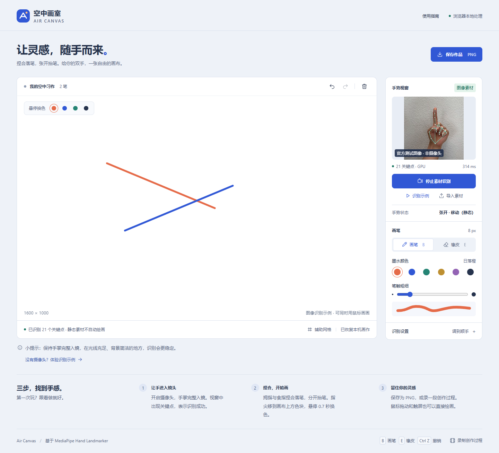

# 空中画室 · Air Canvas

一个基于 **MediaPipe Hand Landmarker** 的浏览器手势绘画程序。摄像头识别手部 21 个关键点，拇指与食指捏合时落笔，分开时抬笔。所有识别在本机浏览器中完成。

> 课程项目：MediaPipe 使用方法调研 + 自主设计与实现交互程序。交付形式为 HTML / CSS / JavaScript 源码。演示视频由提交者自行录制，仓库内提供录制流程。



## 快速运行

### Windows

安装 [Node.js 18 或以上版本](https://nodejs.org/)，下载或克隆本仓库后，双击 **`启动空中画室.bat`**。

程序会打开 `http://localhost:4173`。关闭命令窗口即停止本地服务。

### 命令行

```bash
git clone https://github.com/yeyu6523/mediapipe-air-canvas.git
cd mediapipe-air-canvas
npm start
```

打开 `http://localhost:4173`，推荐使用桌面 Chrome 或 Edge。本仓库已经包含官方模型、运行库和 WASM，**运行不需要先执行 npm install，也不需要 API Key 或互联网连接**。

如果需要重新准备依赖：

```bash
npm ci
npm run setup
```

**不要直接双击 `index.html`。** 项目使用浏览器模块与 Worker，需要 HTTP 服务；摄像头要求 localhost 或 HTTPS。也可在仓库目录运行 `python -m http.server 4173 --bind 127.0.0.1`，再访问本地地址。

## 交互方式

| 操作 | 使用方法 |
| --- | --- |
| 开始识别 | 点击「开启摄像头」，允许浏览器访问摄像头 |
| 移动笔尖 | 将手掌完整放入镜头，移动食指尖 |
| 落笔 / 抬笔 | 拇指与食指捏合 / 分开 |
| 悬停换色 | 抬笔，将指尖移动到画布顶部色块并停留约 0.7 秒 |
| 画笔 / 橡皮 | 点击工具，或按 `B` / `E` |
| 粗细 | 拖动「笔触粗细」滑块 |
| 撤销 / 重做 | `Ctrl+Z` / `Ctrl+Shift+Z`；也支持 `Ctrl+Y` |
| 清空 | 点击垃圾桶并确认；清空之后仍可撤销 |
| 保存 | 点击「保存作品」，导出白底 1600 × 1000 PNG |
| 录制 | 页面底部「录制创作过程」，再次点击结束并下载无声视频，最长 3 分钟 |
| 替代输入 | 鼠标拖动 / 触屏；识别示例；导入图片或视频 |

画作会自动保存到当前浏览器的本机存储中，重新打开可以恢复。浏览器禁止存储或空间不足时，可直接导出 PNG。使用简单画面并保持手掌完整入镜；识别较慢时仍可使用鼠标。

## 不连接摄像头也可以检查

1. 点击「识别示例」，程序会对官方 `pointing_up.jpg` **实际运行 MediaPipe 模型**，在右侧展示骨架和检测状态。
2. 静态图片不会自动绘画；此时可以用鼠标在画布上绘画。
3. 「导入素材」可选择 `assets/hand-motion.mp4`，检查视频解码、真实逐帧识别和光标移动。

`hand-motion.mp4` 是将官方静态测试图像平移后生成的**合成运动素材**，并非真人录像，也不含捏合变化。它只用于视频输入测试，不能证明真人捏合绘画已实测。

## MediaPipe 如何接入

详细调研见 [MediaPipe 使用方法与设计说明](docs/MEDIAPIPE_RESEARCH.md)。

```text
摄像头 / 导入素材
  → createImageBitmap：缩放画面、限制推理输入大小
  → Web Worker：运行 MediaPipe Hand Landmarker
  → 21 个归一化关键点
  → 手掌归一化捏合距离 + 双阈值迟滞 + 两帧确认
  → 指尖坐标镜像 + 时间平滑
  → Canvas 绘画 / 悬停选色
```

推理与 UI 分线程：识别线程繁忙时不排队积压画面，最多保留一个正在推理的帧。优先使用 GPU，初始化失败或检测到软件图形实现时尝试 CPU。实际速度取决于硬件；视窗中的 `ms` 是当次推理耗时，不是承诺帧率。

## 文件结构

```text
index.html                  页面入口
styles.css                  响应式界面
src/app.js                  输入、状态、绘画交互、导出与录制
src/vision-worker.js        MediaPipe 初始化和逐帧推理
src/gestures.js             捏合、平滑、悬停判定
src/drawing.js              Canvas 笔画、历史、持久化
assets/                    模型、官方测试图像、合成测试视频
vendor/mediapipe/           固定版本的官方 JS / WASM
scripts/server.mjs         仅监听本机的静态服务
scripts/setup.mjs          重建本地依赖
tests/                     手势和画布逻辑测试
docs/MEDIAPIPE_RESEARCH.md  调研、方案和实现说明
docs/VALIDATION.md          真实验证结果与限制
docs/DEMO_GUIDE.md          自行录制演示视频的流程
```

## 验证

```bash
npm run check
npm test
```

已完成 **11 项逻辑测试、15 项浏览器功能检查、7 项媒体与本地依赖检查**。详见 [验证记录](docs/VALIDATION.md)。浏览器检查脚本可以通过 Playwright CLI 复现：

```bash
npx --yes --package @playwright/cli playwright-cli open http://localhost:4173
npx --yes --package @playwright/cli playwright-cli run-code --filename=scripts/browser-check.cjs
npx --yes --package @playwright/cli playwright-cli run-code --filename=scripts/browser-media-check.cjs
```

**验证边界：** 完成了真实图像 / 视频素材推理，以及手势判定单元测试；未完成真人摄像头捏合绘画实测。提交者录制视频时应开启自己的摄像头完成该环节。移动端已经检查布局和画布比例，未覆盖所有手机浏览器的摄像头 / Worker 兼容性。

## 许可与来源

原创应用代码使用 [MIT License](LICENSE)。MediaPipe、模型和测试素材保留上游来源与适用许可，见 [THIRD_PARTY_NOTICES.md](THIRD_PARTY_NOTICES.md)；不将第三方文件重新许可为 MIT。
